# اطلس ترسیم‌های این بخش

**تعداد مدخل‌های اصلی این بخش:** ۳۱

همهٔ شکل‌ها فایل SVG مستقل هستند. فایل ۰۰۶ «الگوی چهارایوانی» یک دیاگرام موردی از مسجد جامع اصفهان بر پایهٔ پروندهٔ یونسکو است؛ جایگاه ایوان‌ها و ابعاد گزارش‌شده را نشان می‌دهد، اما پلان اندازه‌برداری‌شده یا الگوی یگانهٔ همهٔ مساجد چهارایوانی نیست. سایر ترسیم‌های اولیه تا اتصال به کیس مشخص، شماتیک آموزشی‌اند.

| [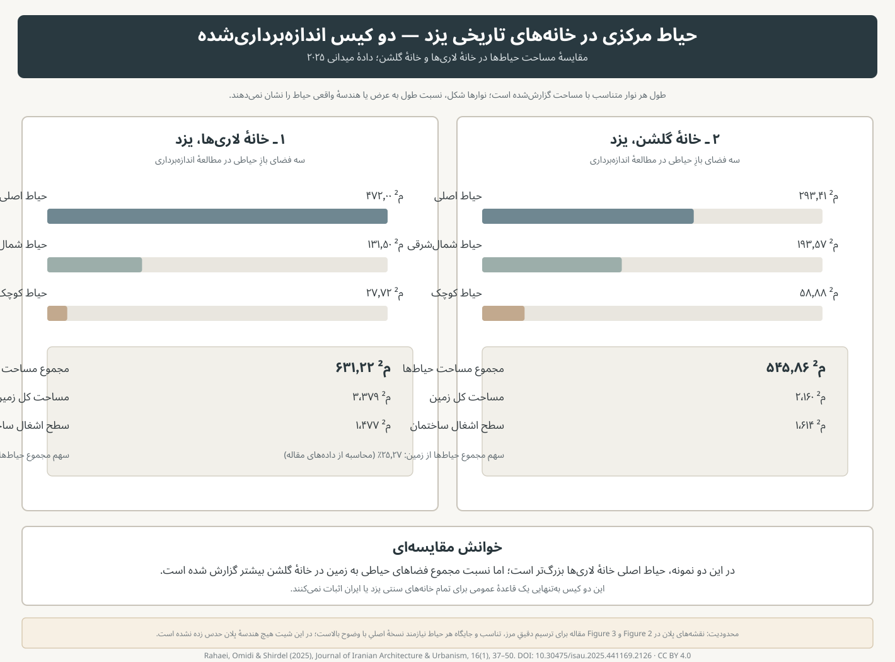](./001-hyat-mrkzy.svg) حیاط مرکزی | [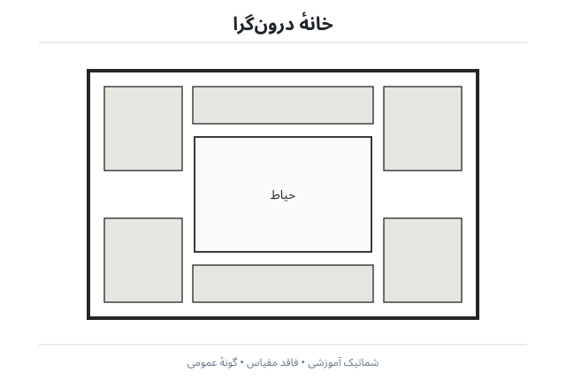](./002-khanh-drvn-gra.svg) خانهٔ درون‌گرا |
|---|---|
| [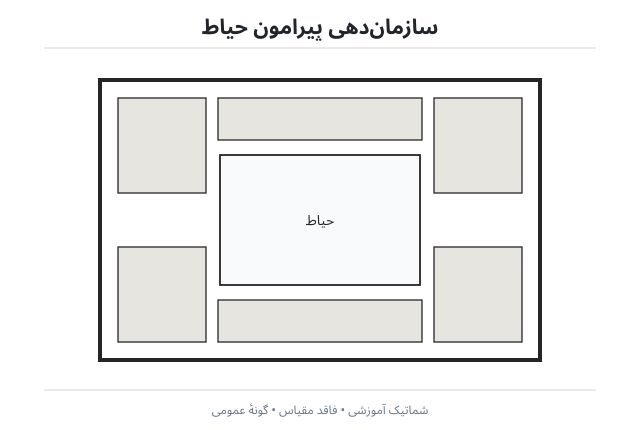](./003-sazman-dhy-pyramvn-hyat.svg) سازمان‌دهی پیرامون حیاط | [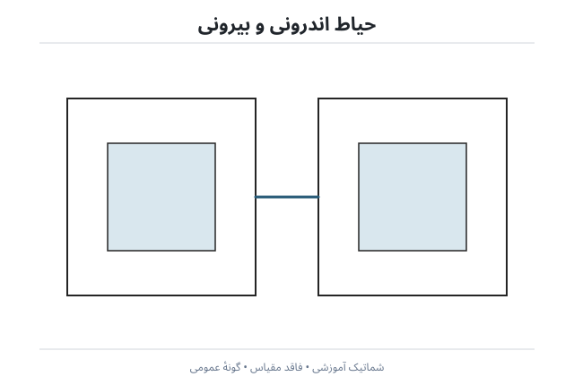](./004-hyat-andrvny-v-byrvny.svg) حیاط اندرونی و بیرونی |
|---|---|
| [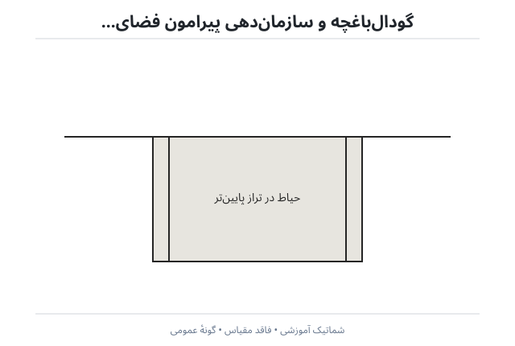](./005-gvdal-baghchh-v-sazman-dhy-pyramvn-fzay-fr.svg) گودال‌باغچه و سازمان‌دهی پیرامون فضای فرورفته | [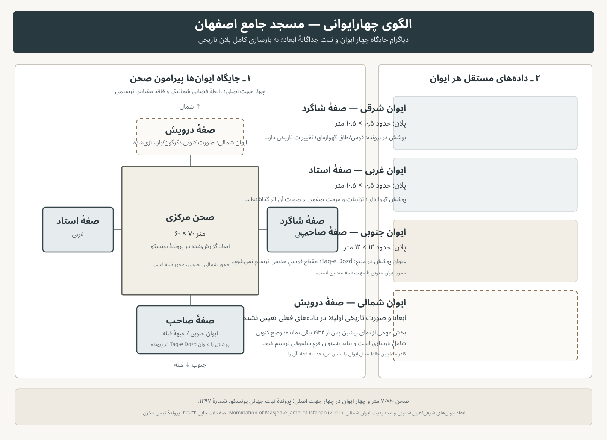](./006-algvy-chharayvany.svg) الگوی چهارایوانی |
|---|---|
| [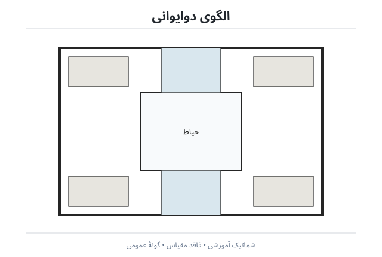](./007-algvy-dvayvany.svg) الگوی دوایوانی | [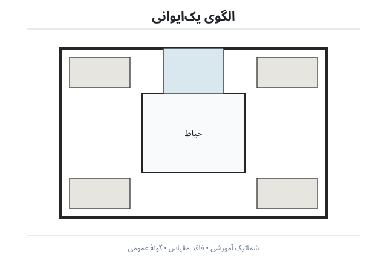](./008-algvy-yk-ayvany.svg) الگوی یک‌ایوانی |
|---|---|
| [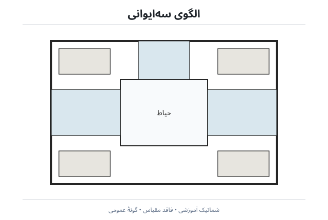](./009-algvy-sh-ayvany.svg) الگوی سه‌ایوانی | [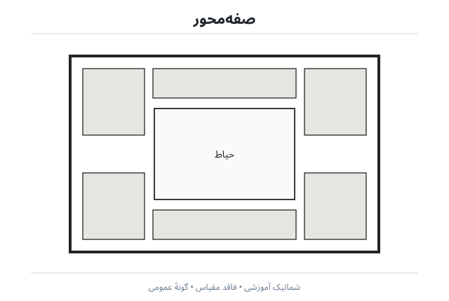](./010-sfh-mhvr.svg) صفه‌محور |
|---|---|
| [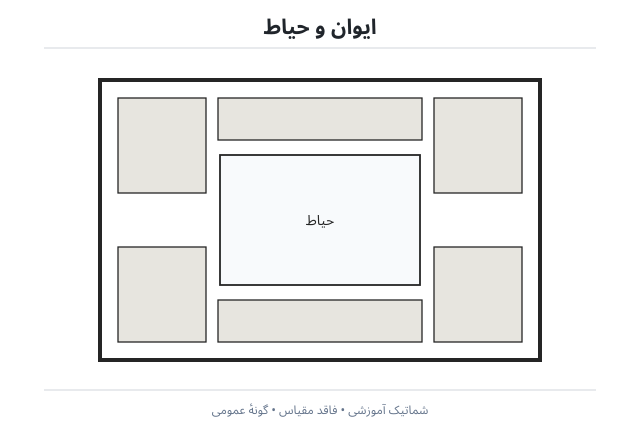](./011-ayvan-v-hyat.svg) ایوان و حیاط | [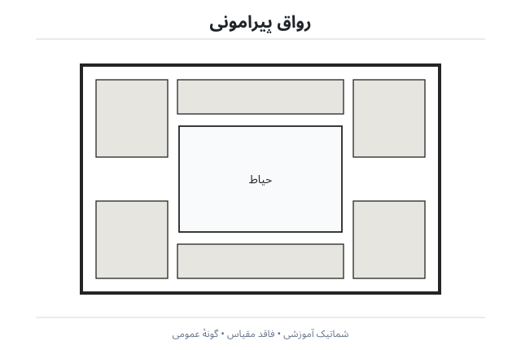](./012-rvaq-pyramvny.svg) رواق پیرامونی |
|---|---|
| [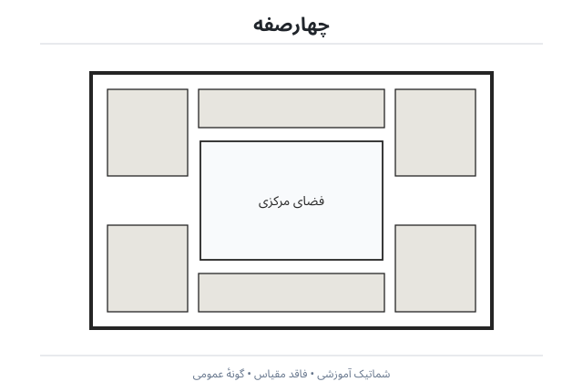](./013-chharsfh.svg) چهارصفه | [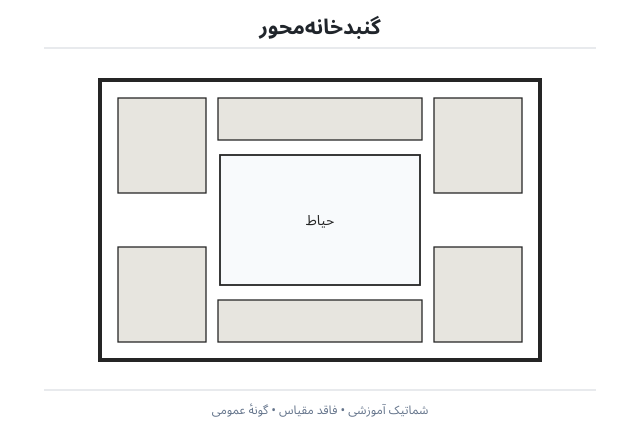](./014-gnbdkhanh-mhvr.svg) گنبدخانه‌محور |
|---|---|
| [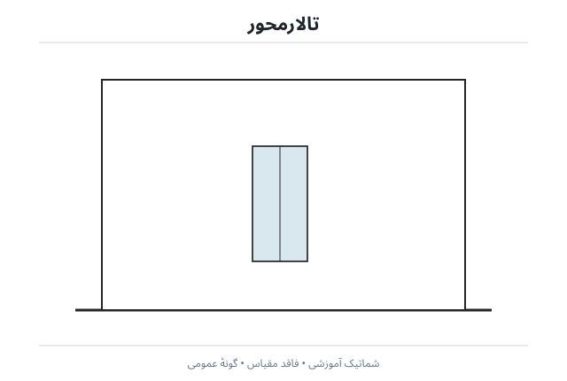](./015-talarmhvr.svg) تالارمحور | [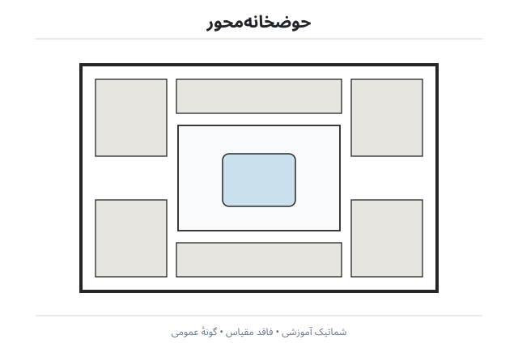](./016-hvzkhanh-mhvr.svg) حوضخانه‌محور |
|---|---|
| [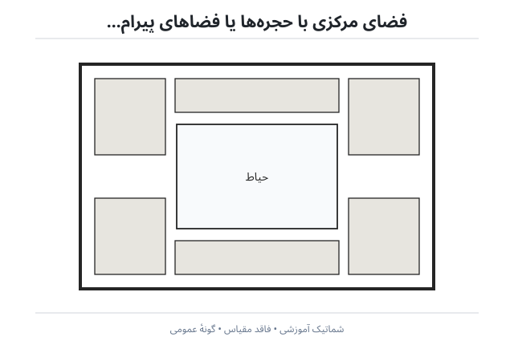](./017-fzay-mrkzy-ba-hjrh-ha-ya-fzahay-pyramvny.svg) فضای مرکزی با حجره‌ها یا فضاهای پیرامونی | [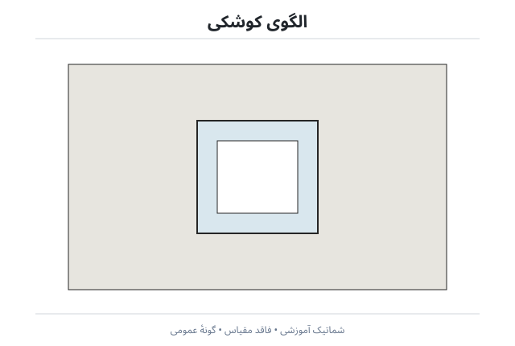](./018-algvy-kvshky.svg) الگوی کوشکی |
|---|---|
| [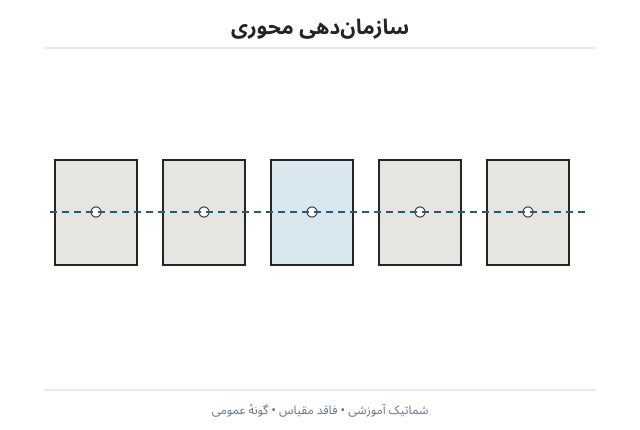](./019-sazman-dhy-mhvry.svg) سازمان‌دهی محوری | [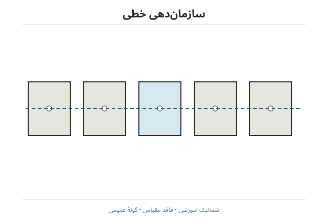](./020-sazman-dhy-khty.svg) سازمان‌دهی خطی |
|---|---|
| [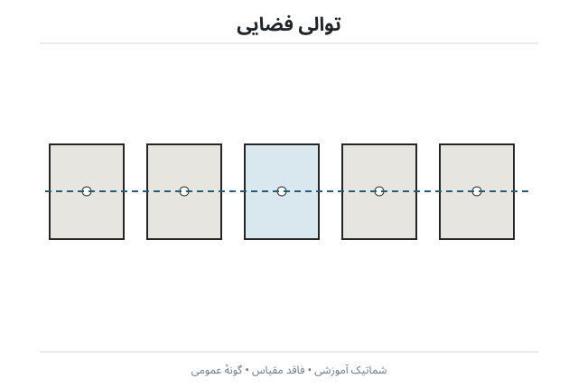](./021-tvaly-fzayy.svg) توالی فضایی | [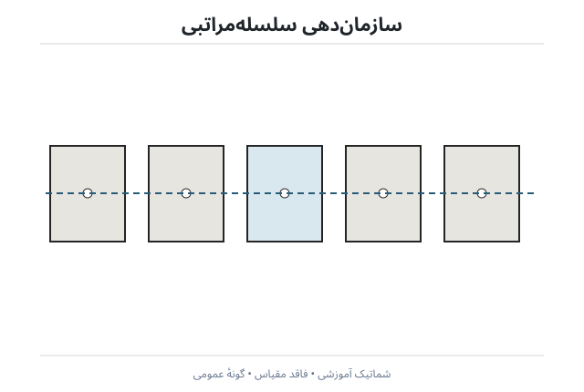](./022-sazman-dhy-slslh-mratby.svg) سازمان‌دهی سلسله‌مراتبی |
|---|---|
| [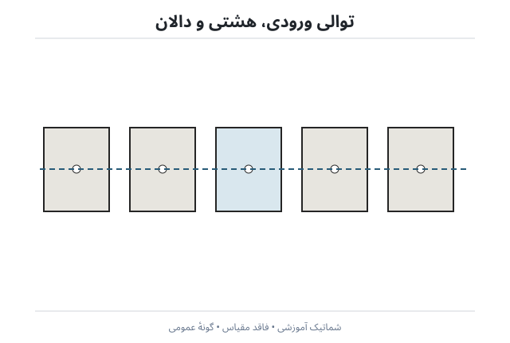](./023-tvaly-vrvdy-hshty-v-dalan.svg) توالی ورودی، هشتی و دالان |  محور اصلی و محورهای فرعی |
|---|---|
| [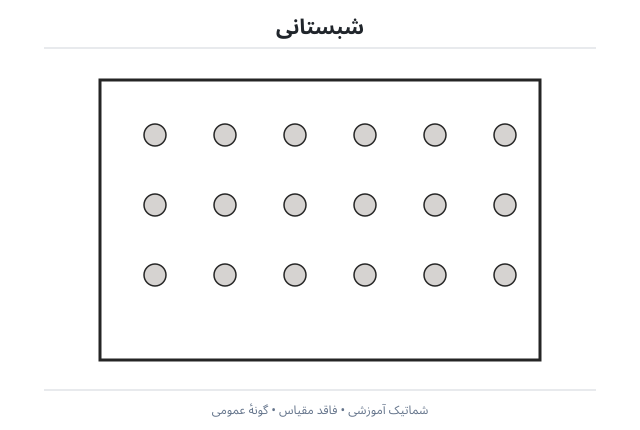](./025-shbstany.svg) شبستانی | [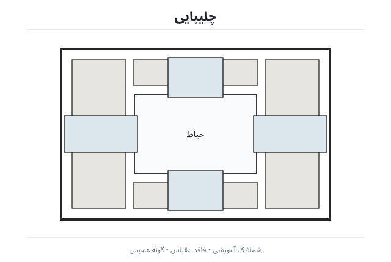](./026-chlypayy.svg) چلیپایی |
|---|---|
| [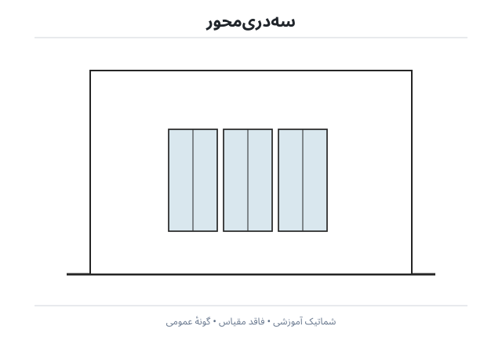](./027-sh-dry-mhvr.svg) سه‌دری‌محور | [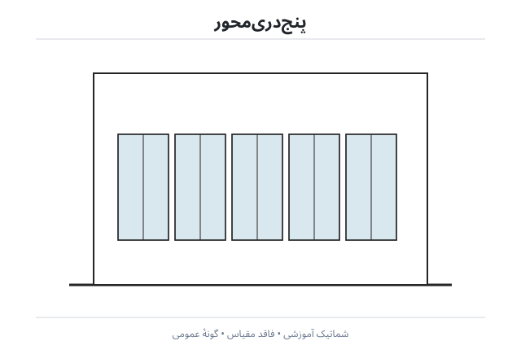](./028-pnj-dry-mhvr.svg) پنج‌دری‌محور |
|---|---|
| [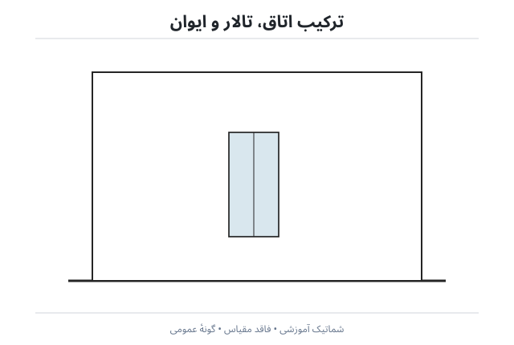](./029-trkyb-ataq-talar-v-ayvan.svg) ترکیب اتاق، تالار و ایوان | [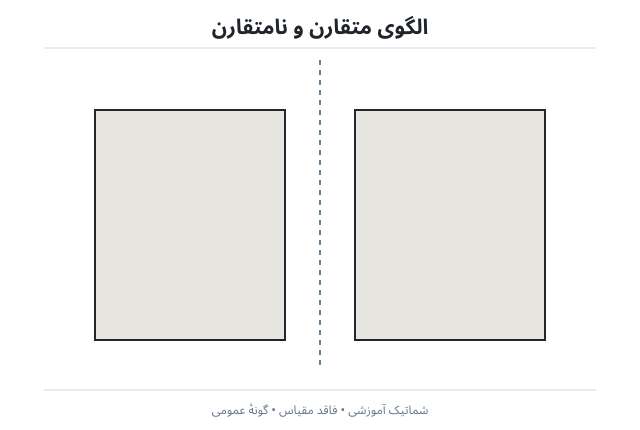](./030-algvy-mtqarn-v-namtqarn.svg) الگوی متقارن و نامتقارن |
|---|---|
| [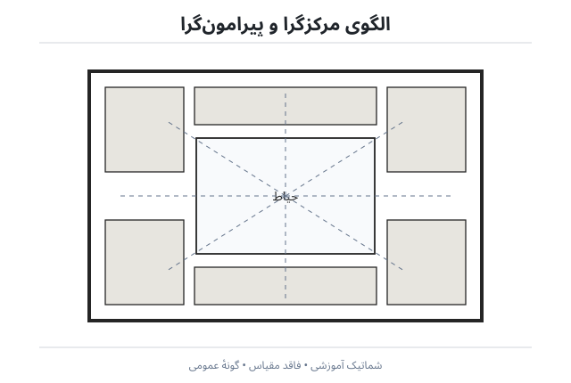](./031-algvy-mrkzgra-v-pyramvn-gra.svg) الگوی مرکزگرا و پیرامون‌گرا |  |
|---|---|
