# اطلس ترسیم‌های این بخش

**تعداد مدخل‌های ترسیم‌شده:** 30

همهٔ شکل‌ها فایل SVG مستقل هستند. فایل ۰۰۸ «هشت‌ضلعی» اکنون بر پایهٔ پلان فتوگرامتری برج شرقی خرقان بازترسیم شده و نمونهٔ مشخصی از هندسهٔ هشت‌ضلعی است؛ سایر فایل‌ها تا زمان اتصال به کیس مستند، شماتیک آموزشی‌اند.

| [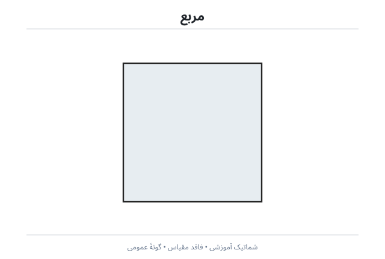](./001-mrba.svg) مربع | [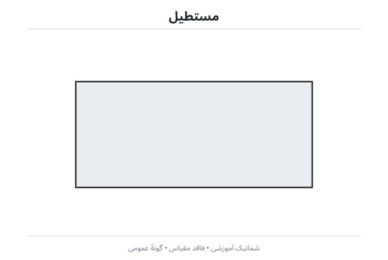](./002-msttyl.svg) مستطیل |
|---|---|
| [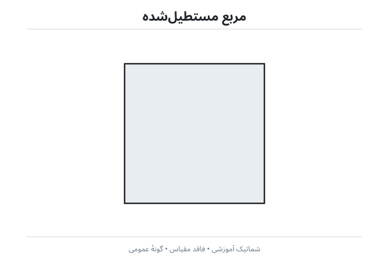](./003-mrba-msttyl-shdh.svg) مربع مستطیل‌شده | [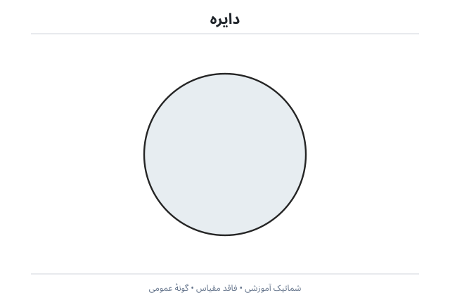](./004-dayrh.svg) دایره |
|---|---|
| [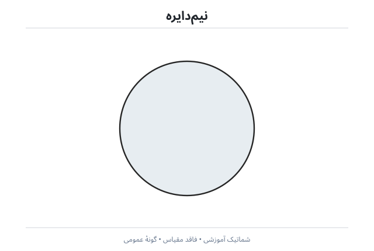](./005-nym-dayrh.svg) نیم‌دایره | [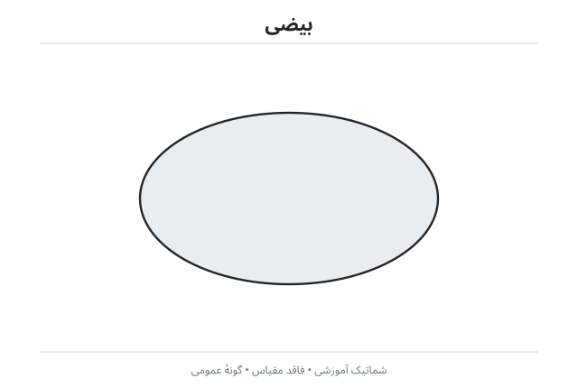](./006-byzy.svg) بیضی |
|---|---|
| [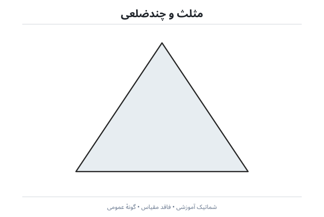](./007-msls-v-chndzlay.svg) مثلث و چندضلعی | [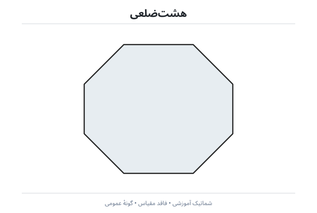](./008-hsht-zlay.svg) هشت‌ضلعی؛ پلان برج شرقی خرقان |
|---|---|
| [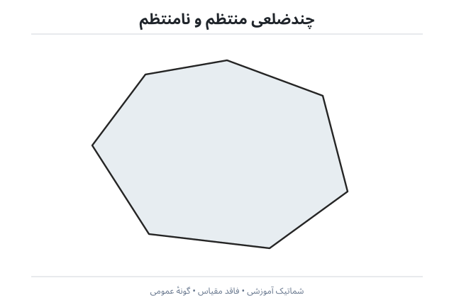](./009-chndzlay-mntzm-v-namntzm.svg) چندضلعی منتظم و نامنتظم | [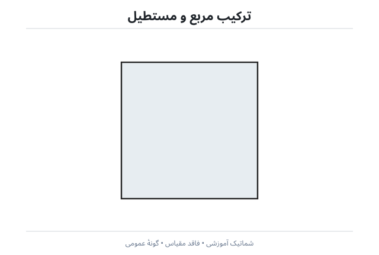](./010-trkyb-mrba-v-msttyl.svg) ترکیب مربع و مستطیل |
|---|---|
| [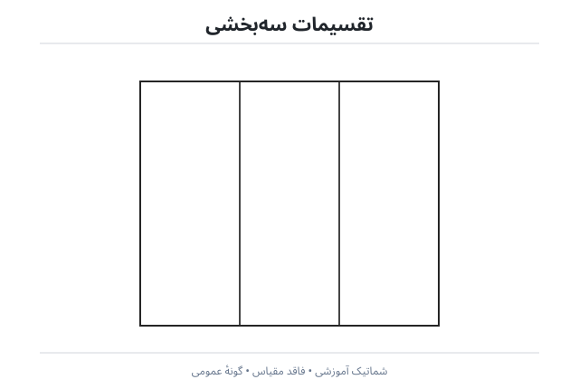](./011-tqsymat-sh-bkhshy.svg) تقسیمات سه‌بخشی | [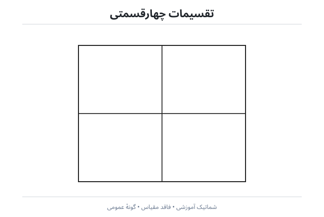](./012-tqsymat-chharqsmty.svg) تقسیمات چهارقسمتی |
|---|---|
| [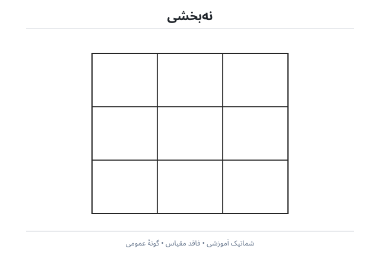](./013-nh-bkhshy.svg) نه‌بخشی | [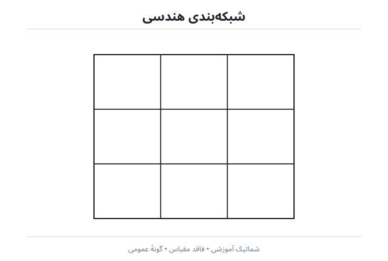](./014-shbkh-bndy-hndsy.svg) شبکه‌بندی هندسی |
|---|---|
| [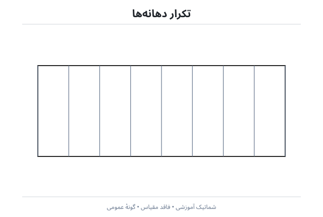](./015-tkrar-dhanh-ha.svg) تکرار دهانه‌ها | [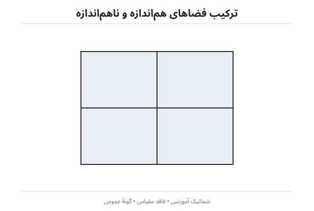](./016-trkyb-fzahay-hm-andazh-v-nahm-andazh.svg) ترکیب فضاهای هم‌اندازه و ناهم‌اندازه |
|---|---|
| [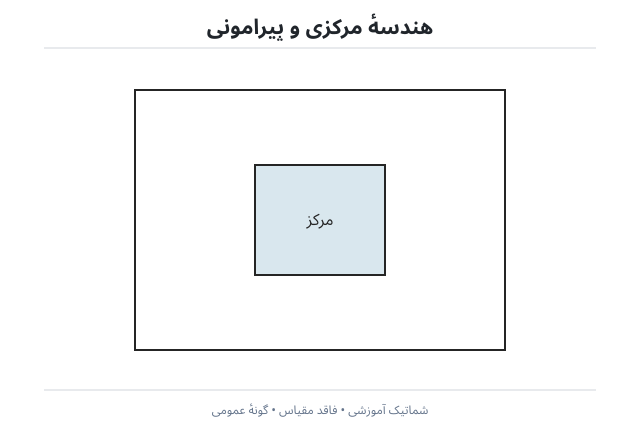](./017-hndsh-mrkzy-v-pyramvny.svg) هندسهٔ مرکزی و پیرامونی | [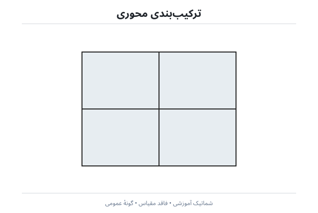](./018-trkyb-bndy-mhvry.svg) ترکیب‌بندی محوری |
|---|---|
| [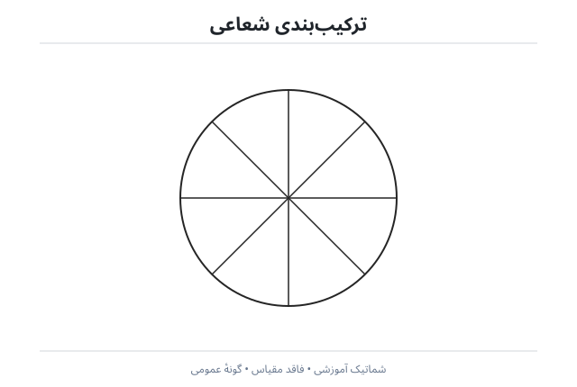](./019-trkyb-bndy-shaaay.svg) ترکیب‌بندی شعاعی | [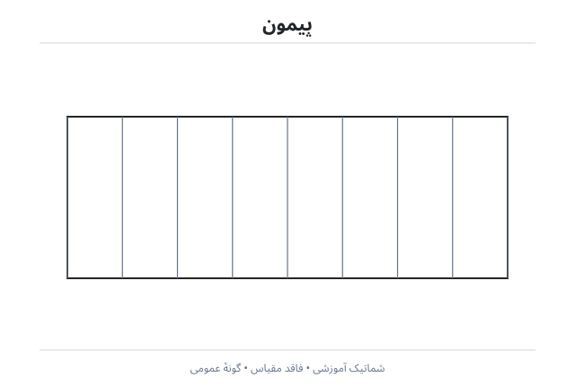](./020-pymvn.svg) پیمون |
|---|---|
| [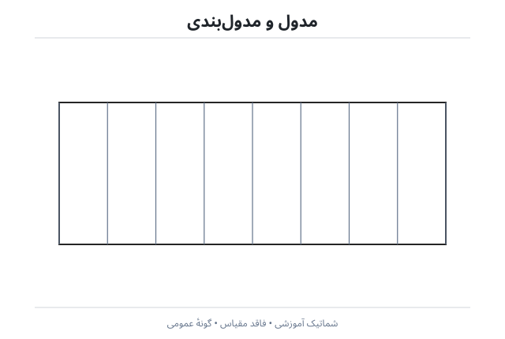](./021-mdvl-v-mdvl-bndy.svg) مدول و مدول‌بندی | [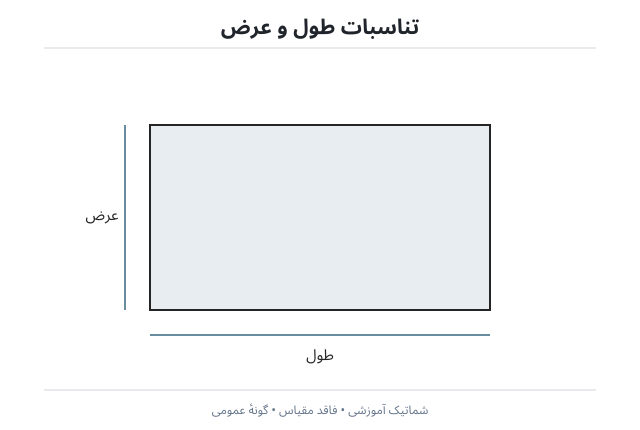](./022-tnasbat-tvl-v-arz.svg) تناسبات طول و عرض |
|---|---|
| [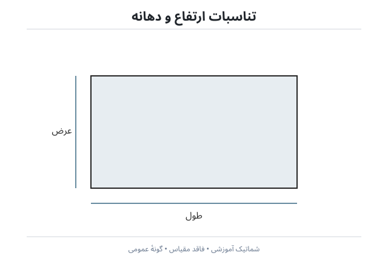](./023-tnasbat-artfaa-v-dhanh.svg) تناسبات ارتفاع و دهانه | [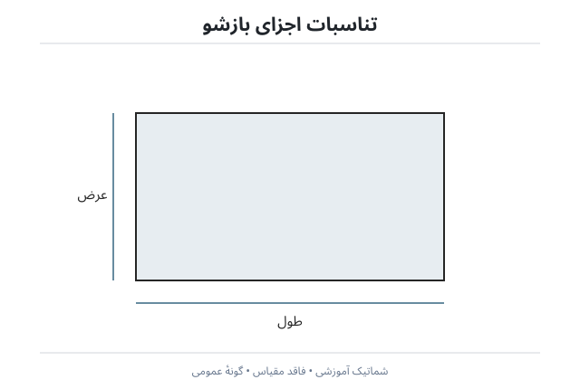](./024-tnasbat-ajzay-bazshv.svg) تناسبات اجزای بازشو |
|---|---|
| [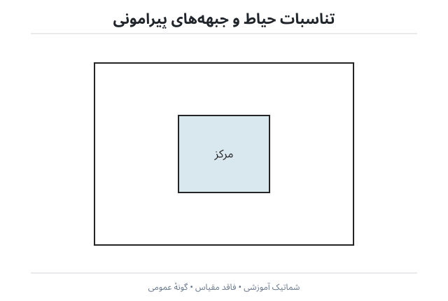](./025-tnasbat-hyat-v-jbhh-hay-pyramvny.svg) تناسبات حیاط و جبهه‌های پیرامونی | [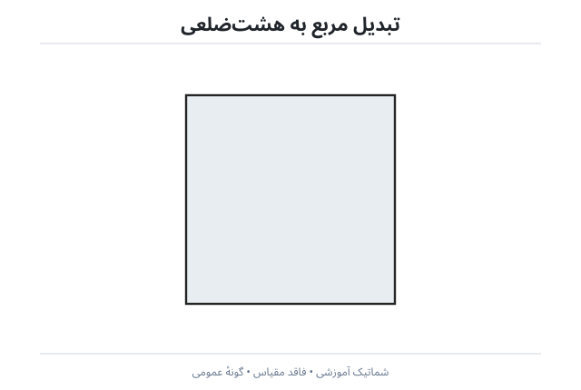](./026-tbdyl-mrba-bh-hsht-zlay.svg) تبدیل مربع به هشت‌ضلعی |
|---|---|
| [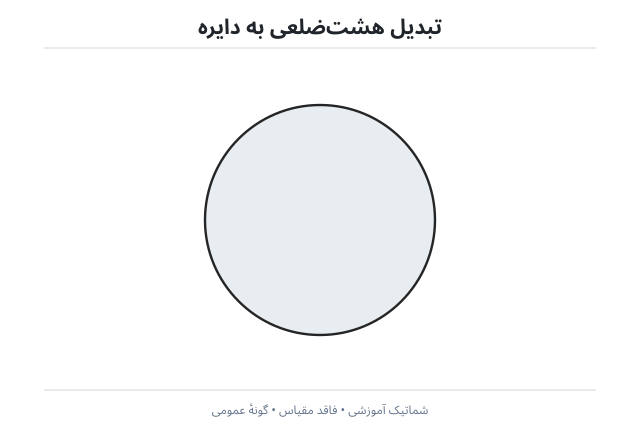](./027-tbdyl-hsht-zlay-bh-dayrh.svg) تبدیل هشت‌ضلعی به دایره | [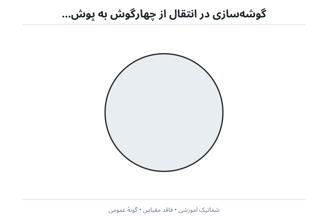](./028-gvshh-sazy-dr-antqal-az-chhargvsh-bh-pvshs.svg) گوشه‌سازی در انتقال از چهارگوش به پوشش مدور |
|---|---|
| [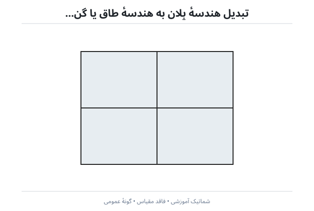](./029-tbdyl-hndsh-plan-bh-hndsh-taq-ya-gnbd.svg) تبدیل هندسهٔ پلان به هندسهٔ طاق یا گنبد | [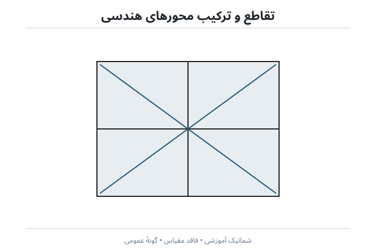](./030-tqata-v-trkyb-mhvrhay-hndsy.svg) تقاطع و ترکیب محورهای هندسی |
|---|---|
