# اطلس ترسیم‌های این بخش

**تعداد مدخل‌های ترسیم‌شده:** 36

همهٔ شکل‌ها فایل SVG مستقل هستند. روی تصویر یا پیوند بزنید تا فایل برداری در اندازهٔ کامل باز شود. ترسیم‌ها شماتیک آموزشی، فاقد مقیاس و غیرمنتسب به بنای تاریخی خاص‌اند.

| [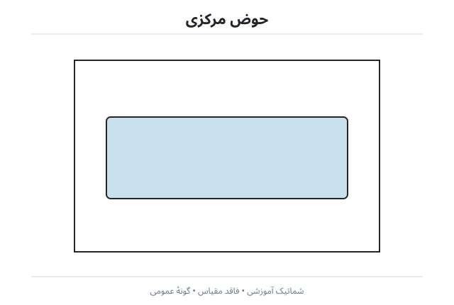](./001-hvz-mrkzy.svg) حوض مرکزی | [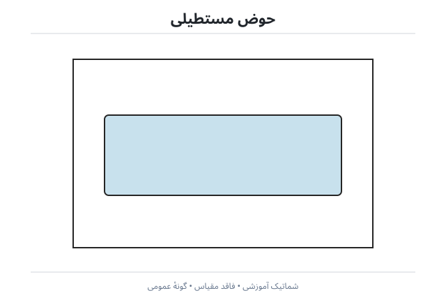](./002-hvz-msttyly.svg) حوض مستطیلی |
|---|---|
| [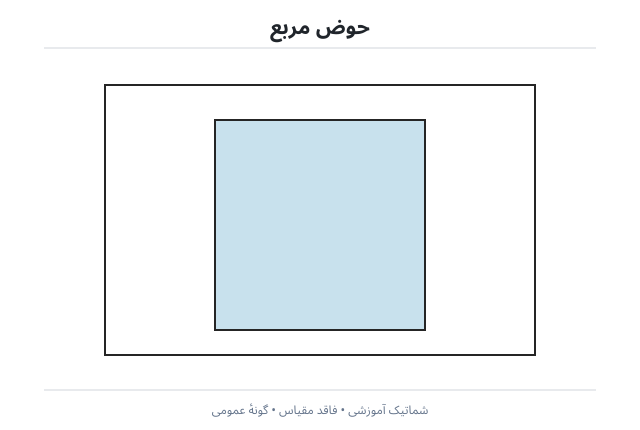](./003-hvz-mrba.svg) حوض مربع | [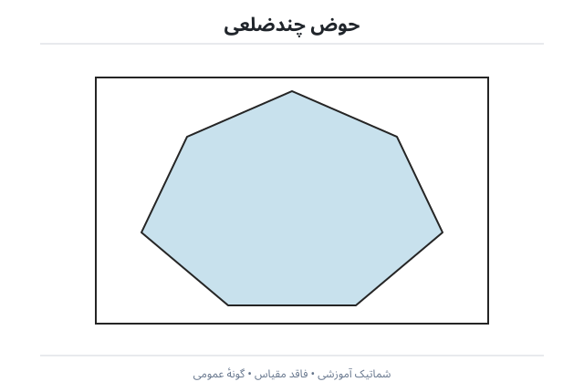](./004-hvz-chndzlay.svg) حوض چندضلعی |
|---|---|
| [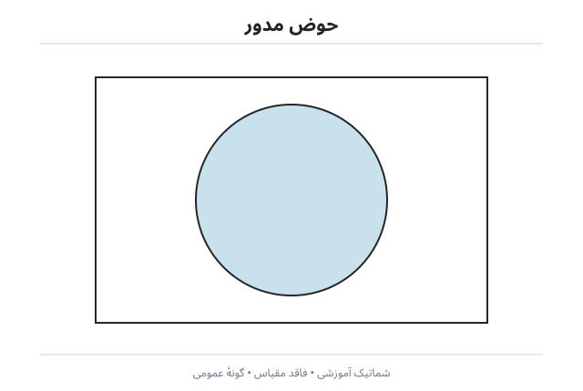](./005-hvz-mdvr.svg) حوض مدور | [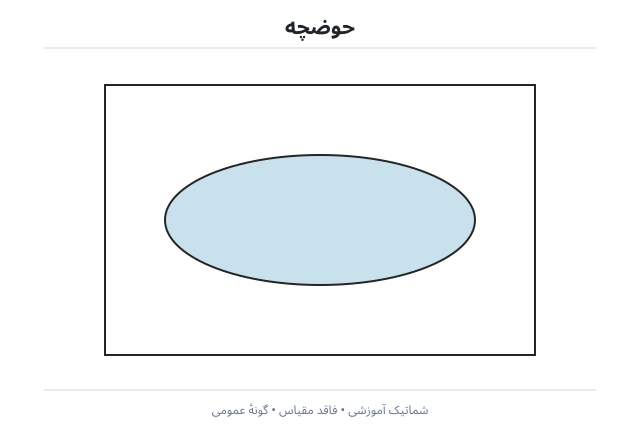](./006-hvzchh.svg) حوضچه |
|---|---|
| [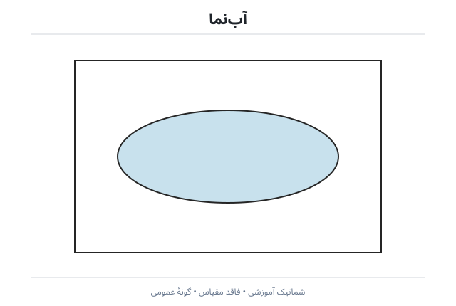](./007-ab-nma.svg) آب‌نما | [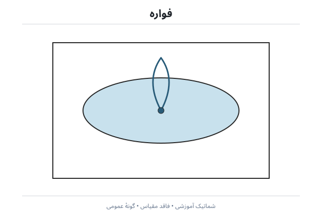](./008-fvarh.svg) فواره |
|---|---|
| [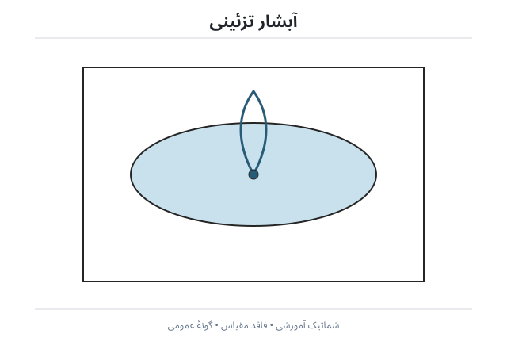](./009-abshar-tzyny.svg) آبشار تزئینی | [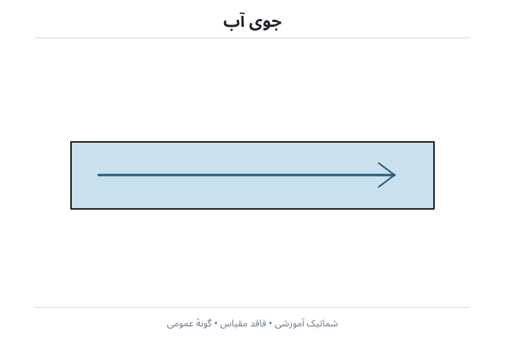](./010-jvy-ab.svg) جوی آب |
|---|---|
| [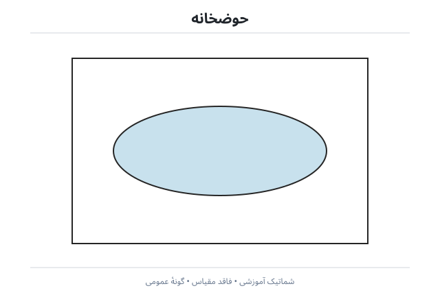](./011-hvzkhanh.svg) حوضخانه | [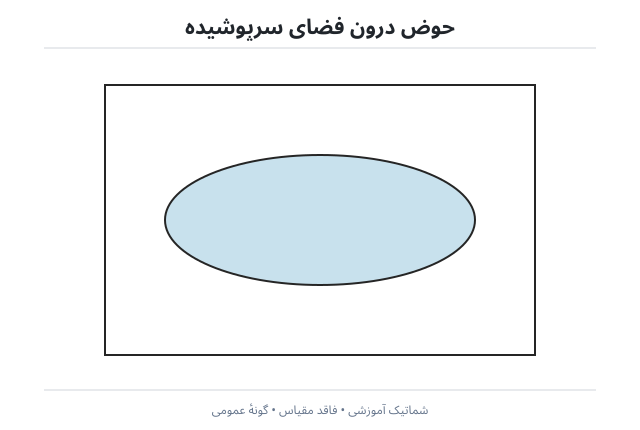](./012-hvz-drvn-fzay-srpvshydh.svg) حوض درون فضای سرپوشیده |
|---|---|
| [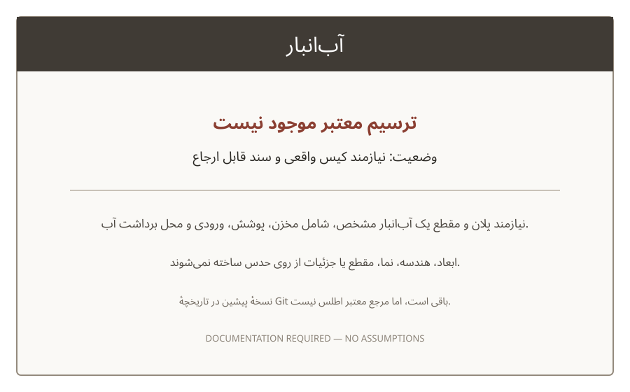](./013-ab-anbar.svg) آب‌انبار | [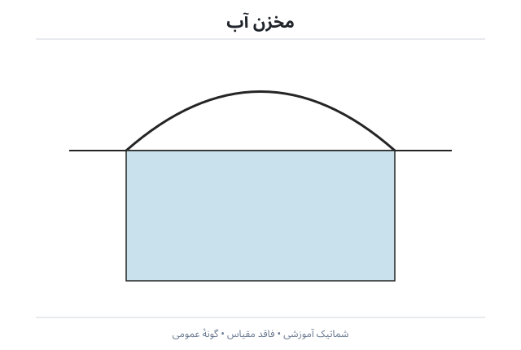](./014-mkhzn-ab.svg) مخزن آب |
|---|---|
| [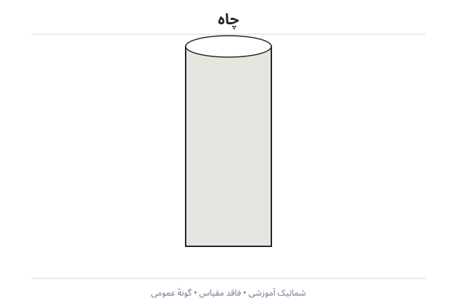](./015-chah.svg) چاه | [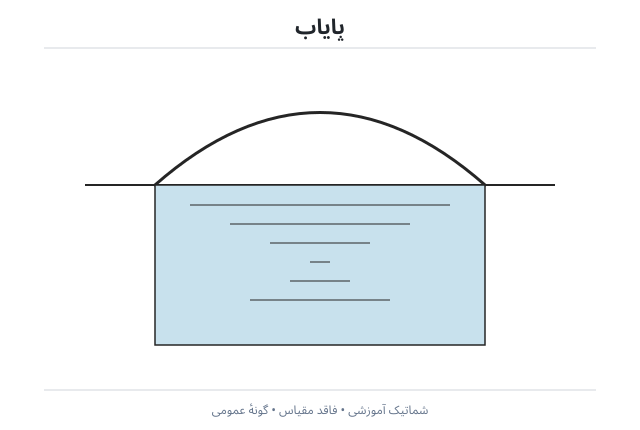](./016-payab.svg) پایاب |
|---|---|
| [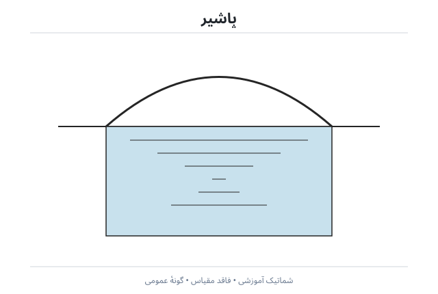](./017-pashyr.svg) پاشیر | [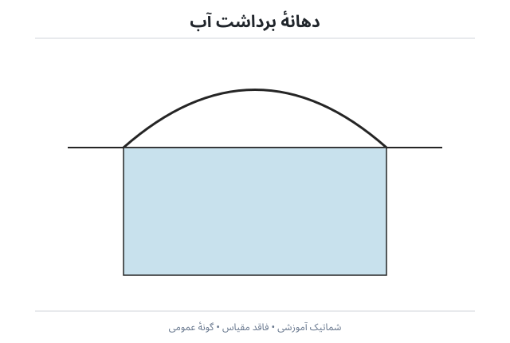](./018-dhanh-brdasht-ab.svg) دهانهٔ برداشت آب |
|---|---|
| [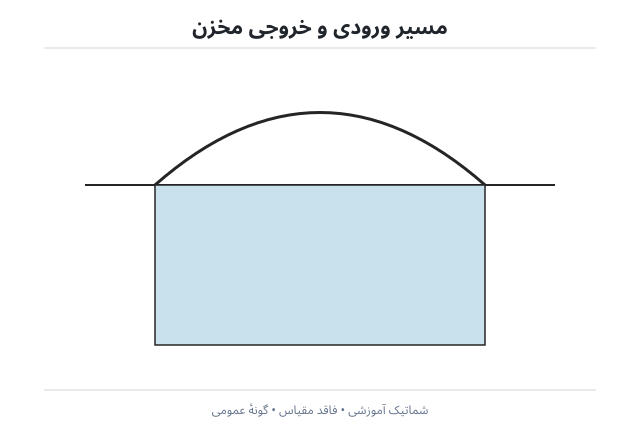](./019-msyr-vrvdy-v-khrvjy-mkhzn.svg) مسیر ورودی و خروجی مخزن | [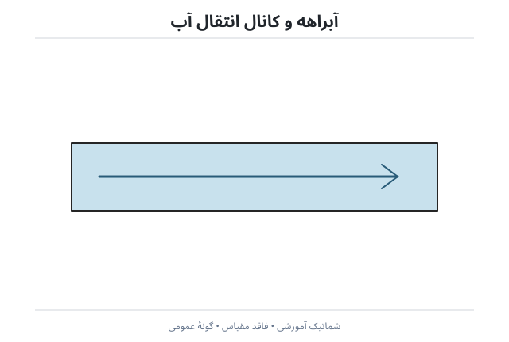](./020-abrahh-v-kanal-antqal-ab.svg) آبراهه و کانال انتقال آب |
|---|---|
| [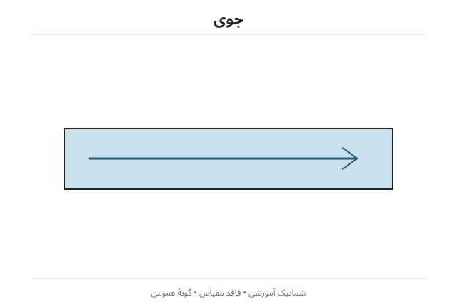](./021-jvy.svg) جوی | [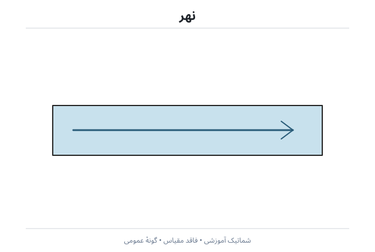](./022-nhr.svg) نهر |
|---|---|
| [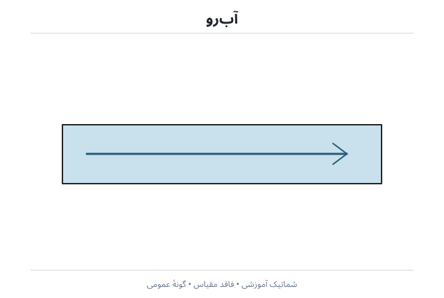](./023-ab-rv.svg) آب‌رو | [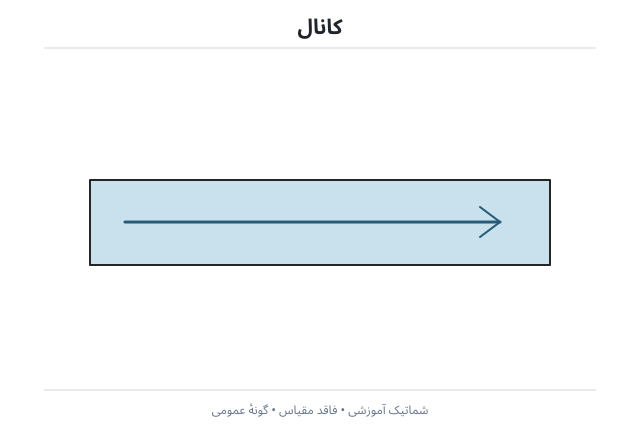](./024-kanal.svg) کانال |
|---|---|
| [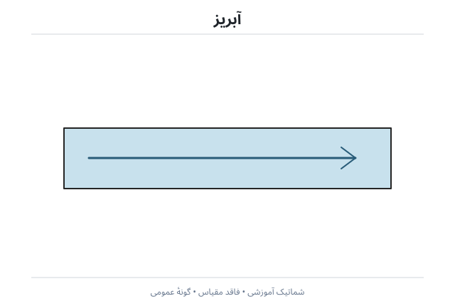](./025-abryz.svg) آبریز | [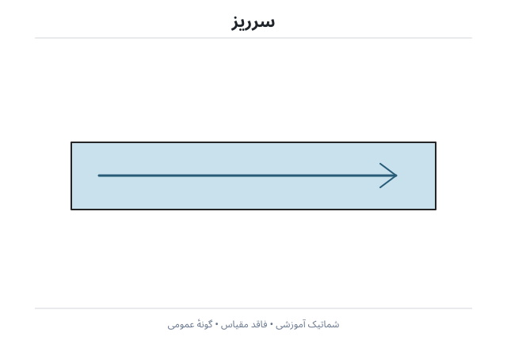](./026-srryz.svg) سرریز |
|---|---|
| [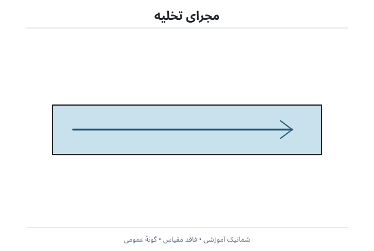](./027-mjray-tkhlyh.svg) مجرای تخلیه | [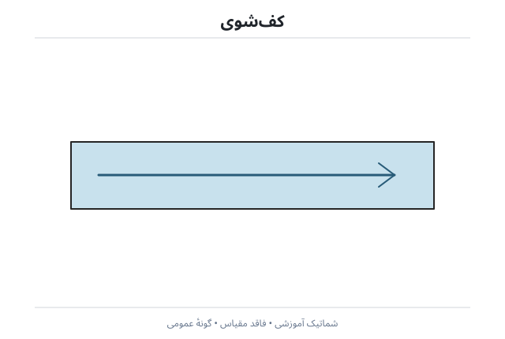](./028-kf-shvy.svg) کف‌شوی |
|---|---|
| [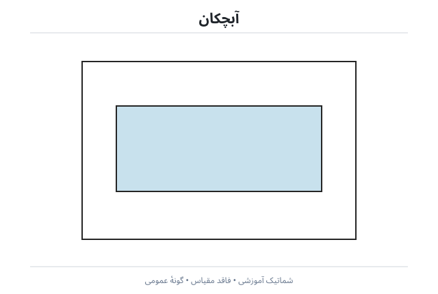](./029-abchkan.svg) آبچکان |  باغچهٔ مرکزی |
|---|---|
| [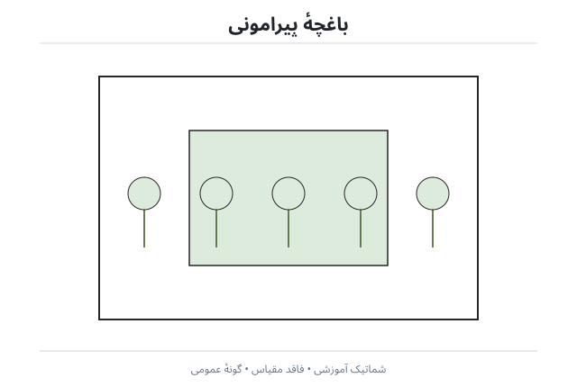](./031-baghchh-pyramvny.svg) باغچهٔ پیرامونی | [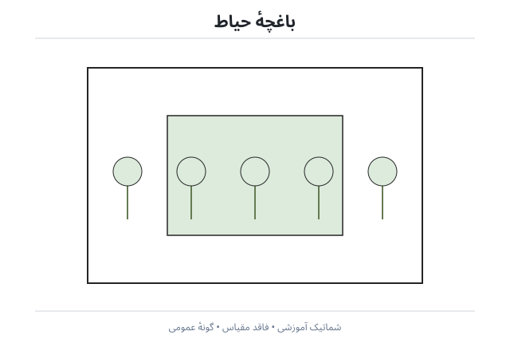](./032-baghchh-hyat.svg) باغچهٔ حیاط |
|---|---|
| [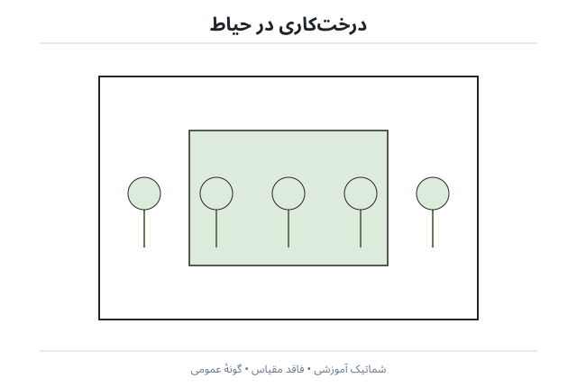](./033-drkht-kary-dr-hyat.svg) درخت‌کاری در حیاط | [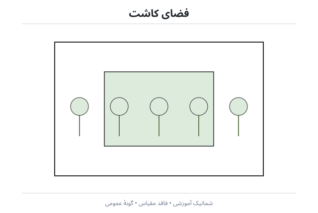](./034-fzay-kasht.svg) فضای کاشت |
|---|---|
| [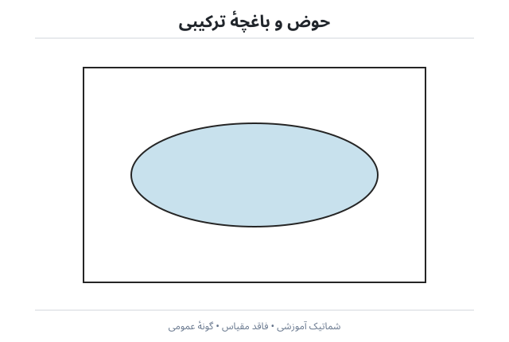](./035-hvz-v-baghchh-trkyby.svg) حوض و باغچهٔ ترکیبی | [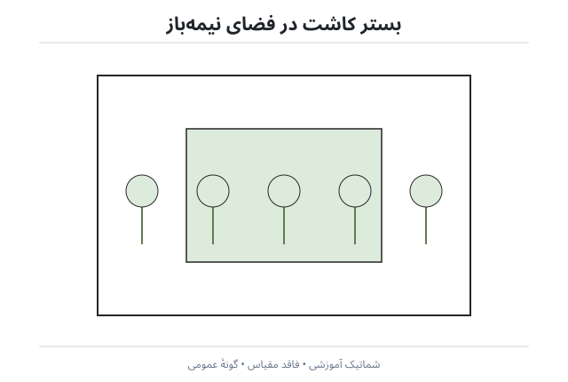](./036-bstr-kasht-dr-fzay-nymh-baz.svg) بستر کاشت در فضای نیمه‌باز |
|---|---|
