# اطلس ترسیم‌های این بخش

**تعداد مدخل‌های ترسیم‌شده:** 31

همهٔ شکل‌ها فایل SVG مستقل هستند. روی تصویر یا پیوند بزنید تا فایل برداری در اندازهٔ کامل باز شود. ترسیم‌ها شماتیک آموزشی، فاقد مقیاس و غیرمنتسب به بنای تاریخی خاص‌اند.

| [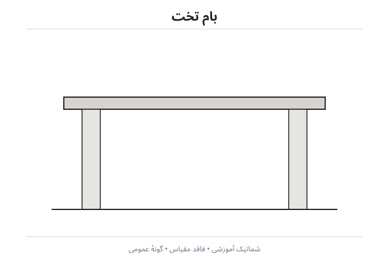](./001-bam-tkht.svg) بام تخت | [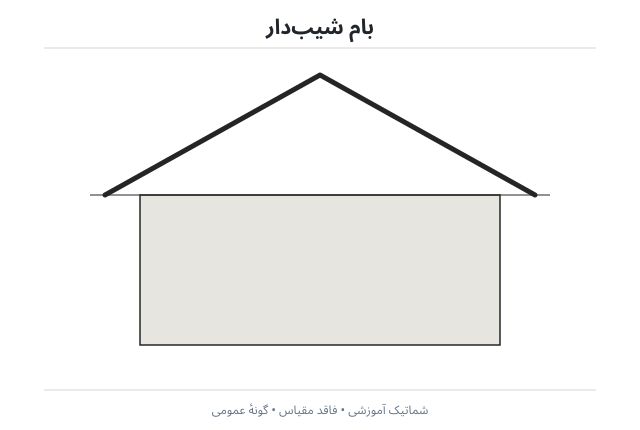](./002-bam-shyb-dar.svg) بام شیب‌دار |
|---|---|
| [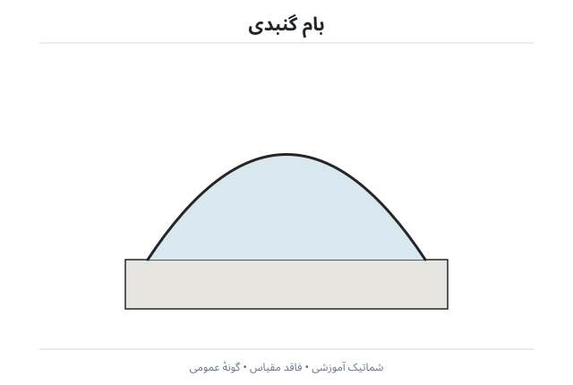](./003-bam-gnbdy.svg) بام گنبدی | [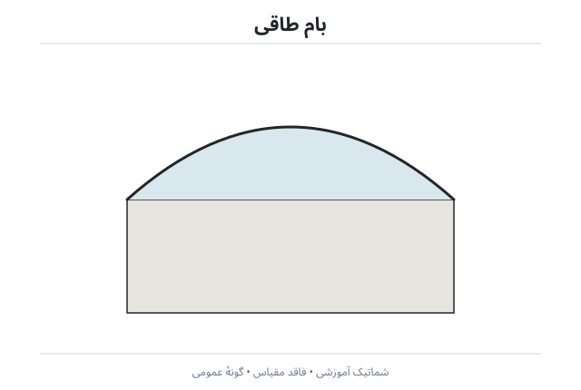](./004-bam-taqy.svg) بام طاقی |
|---|---|
| [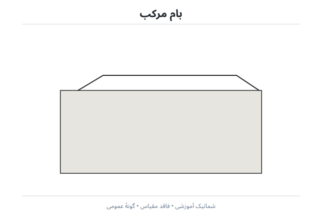](./005-bam-mrkb.svg) بام مرکب | [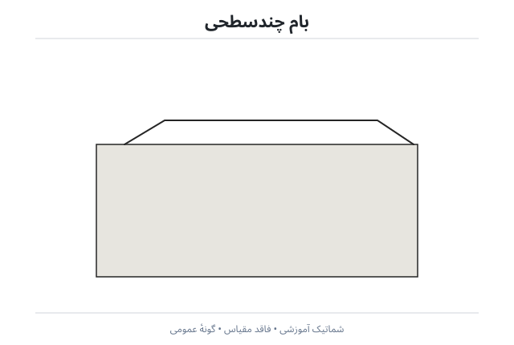](./006-bam-chndsthy.svg) بام چندسطحی |
|---|---|
| [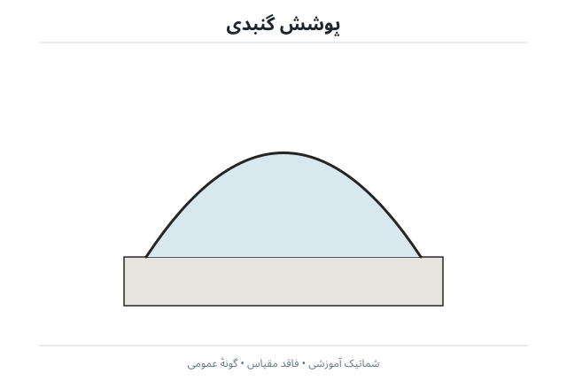](./007-pvshsh-gnbdy.svg) پوشش گنبدی | [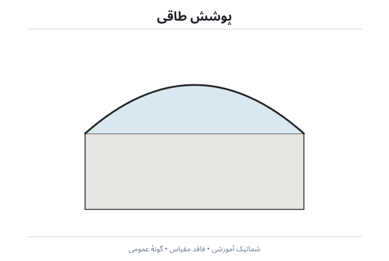](./008-pvshsh-taqy.svg) پوشش طاقی |
|---|---|
| [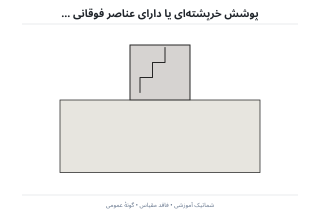](./009-pvshsh-khrpshth-ay-ya-daray-anasr-fvqany-b.svg) پوشش خرپشته‌ای یا دارای عناصر فوقانی (با تعیین مصداق) |  جان‌پناه |
|---|---|
| [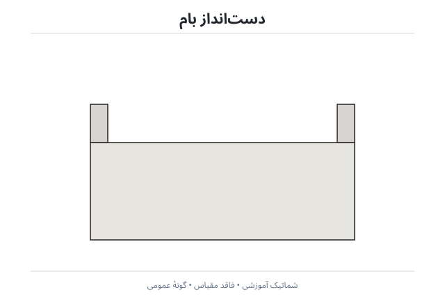](./011-dst-andaz-bam.svg) دست‌انداز بام | [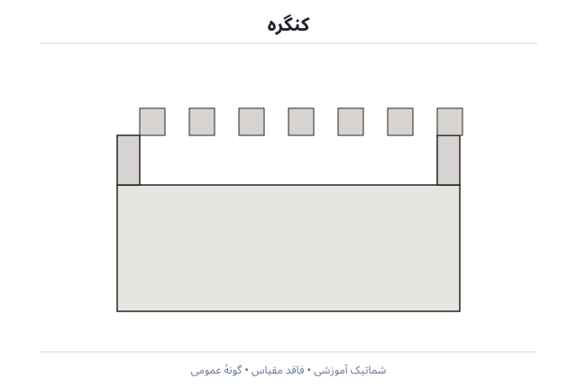](./012-kngrh.svg) کنگره |
|---|---|
| [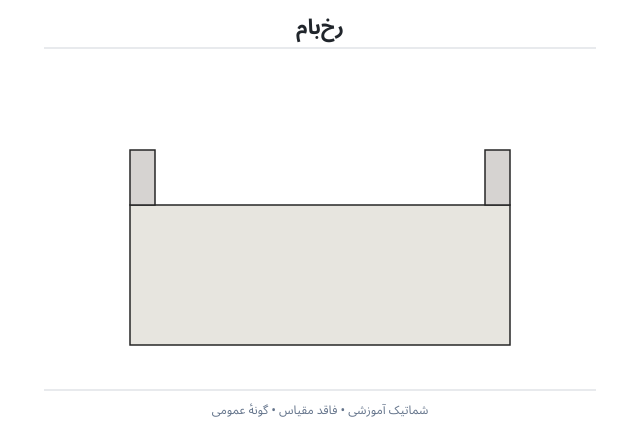](./013-rkh-bam.svg) رخ‌بام | [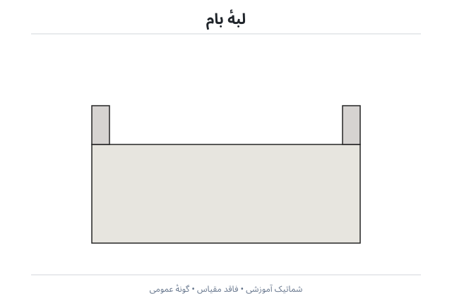](./014-lbh-bam.svg) لبهٔ بام |
|---|---|
| [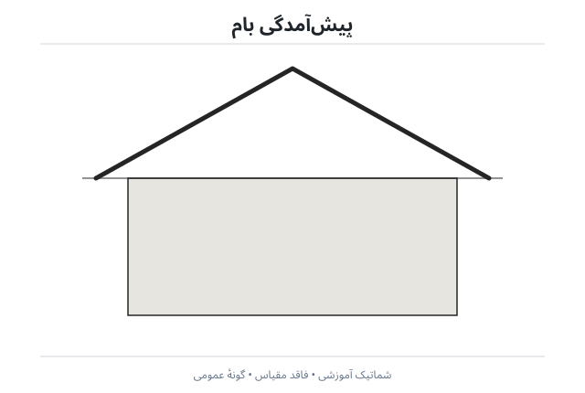](./015-pysh-amdgy-bam.svg) پیش‌آمدگی بام | [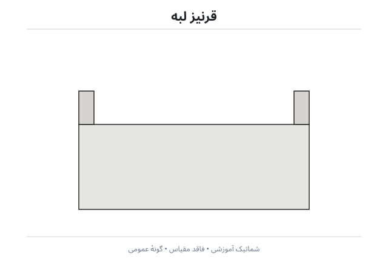](./016-qrnyz-lbh.svg) قرنیز لبه |
|---|---|
| [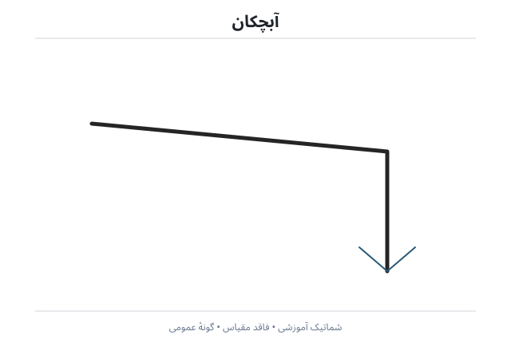](./017-abchkan.svg) آبچکان | [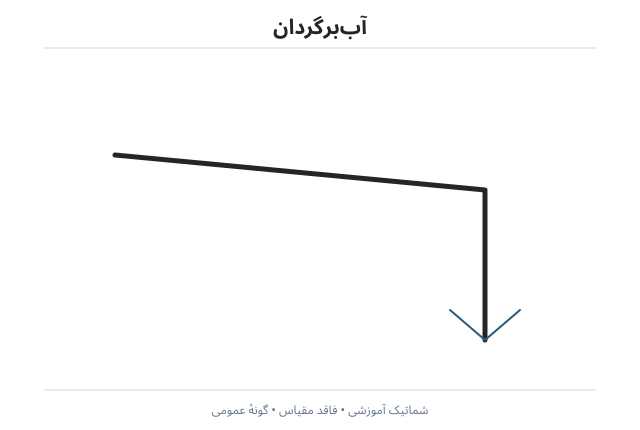](./018-ab-brgrdan.svg) آب‌برگردان |
|---|---|
| [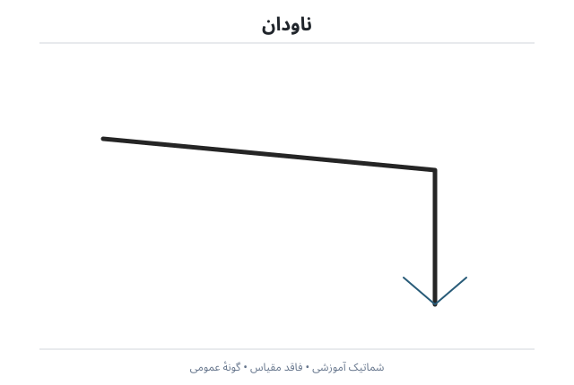](./019-navdan.svg) ناودان |  ناودان عمودی |
|---|---|
| [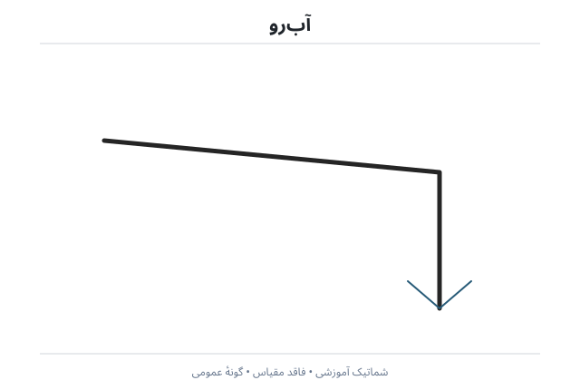](./021-ab-rv.svg) آب‌رو | [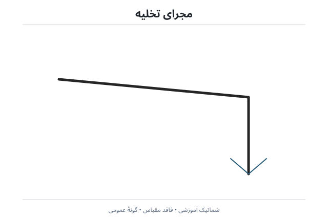](./022-mjray-tkhlyh.svg) مجرای تخلیه |
|---|---|
| [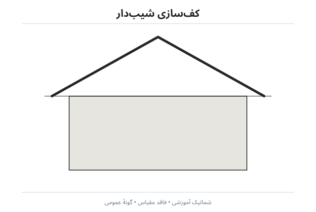](./023-kf-sazy-shyb-dar.svg) کف‌سازی شیب‌دار | [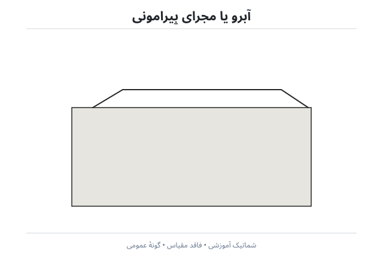](./024-abrv-ya-mjray-pyramvny.svg) آبرو یا مجرای پیرامونی |
|---|---|
| [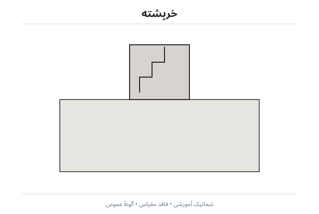](./025-khrpshth.svg) خرپشته | [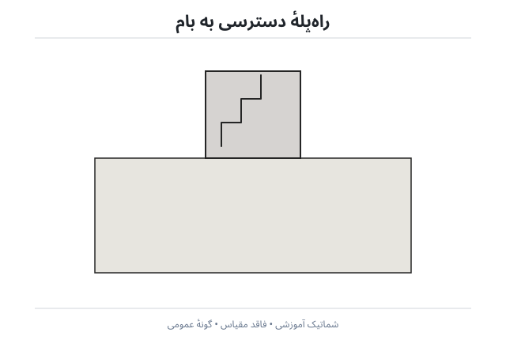](./026-rah-plh-dstrsy-bh-bam.svg) راه‌پلهٔ دسترسی به بام |
|---|---|
| [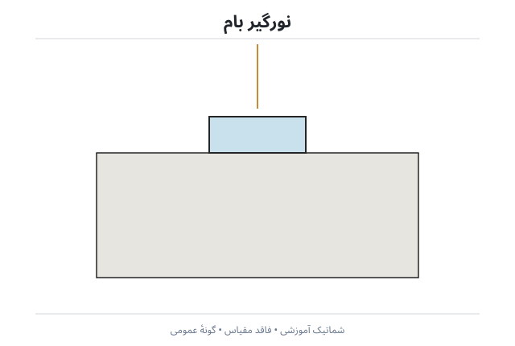](./027-nvrgyr-bam.svg) نورگیر بام | [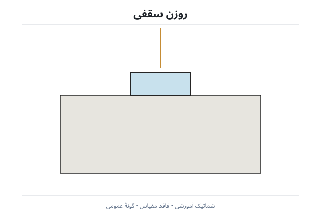](./028-rvzn-sqfy.svg) روزن سقفی |
|---|---|
| [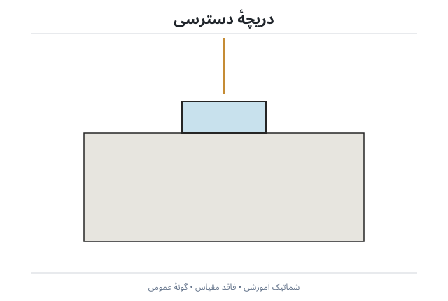](./029-drychh-dstrsy.svg) دریچهٔ دسترسی | [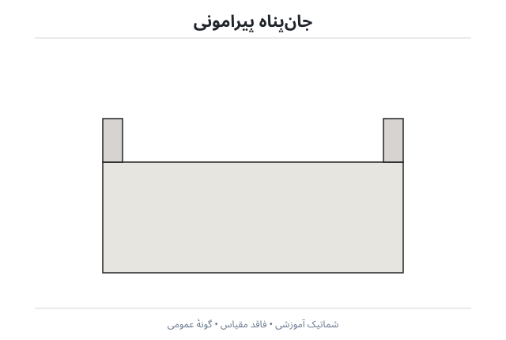](./030-jan-pnah-pyramvny.svg) جان‌پناه پیرامونی |
|---|---|
| [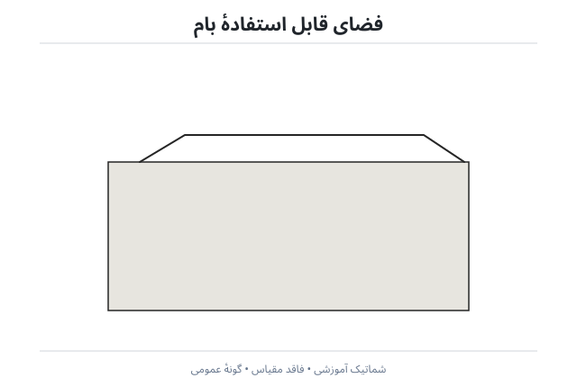](./031-fzay-qabl-astfadh-bam.svg) فضای قابل استفادهٔ بام |  |
|---|---|
